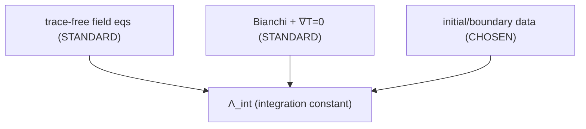
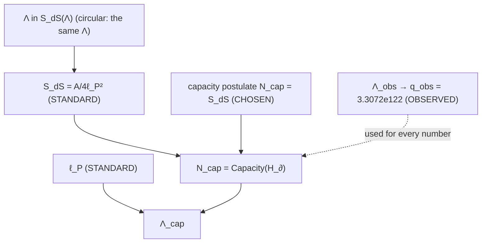
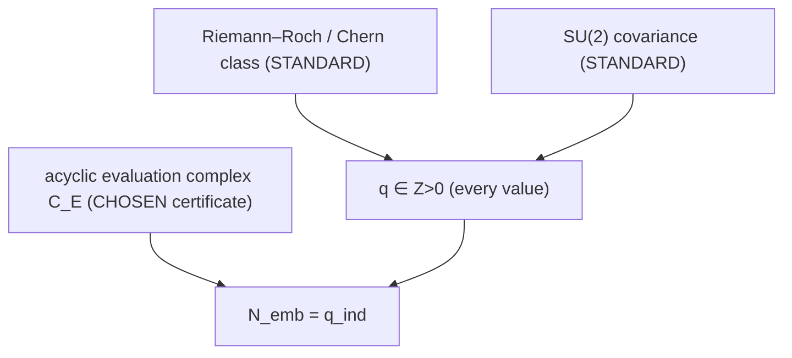
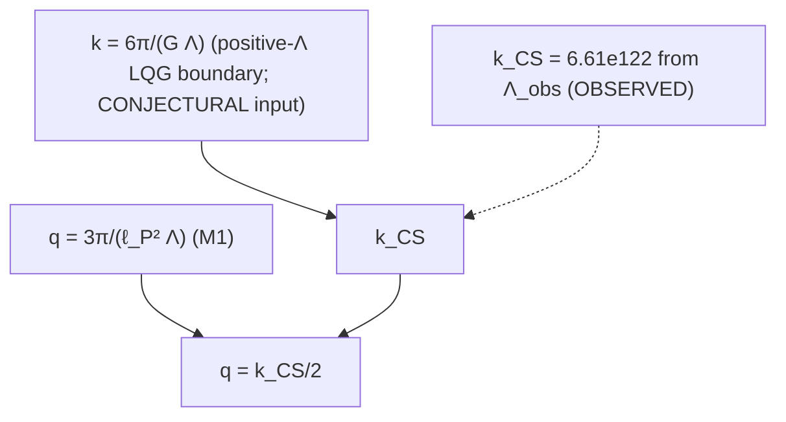
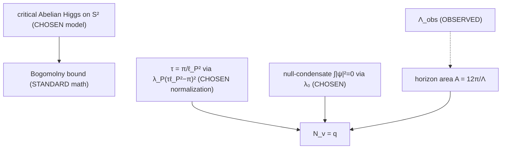
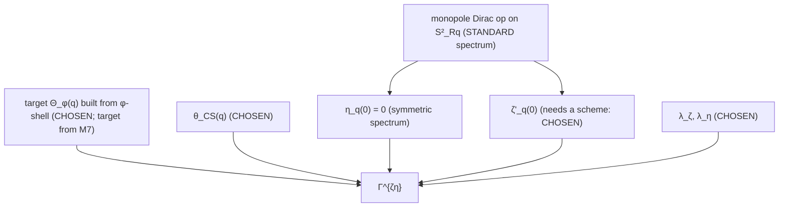
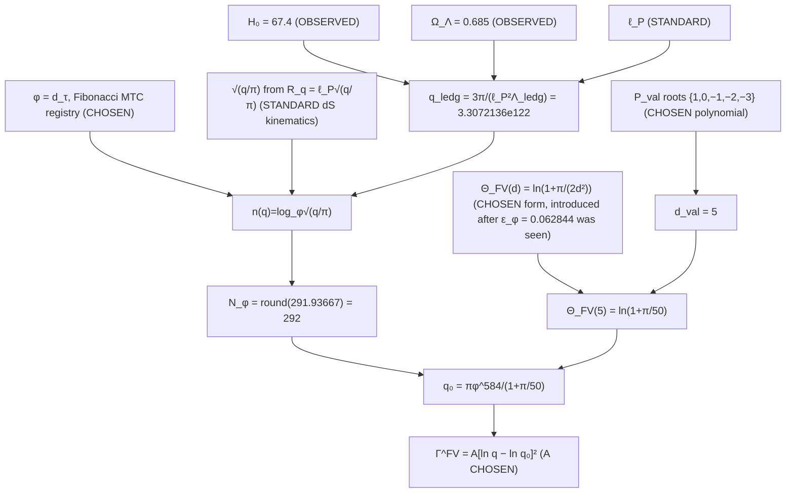
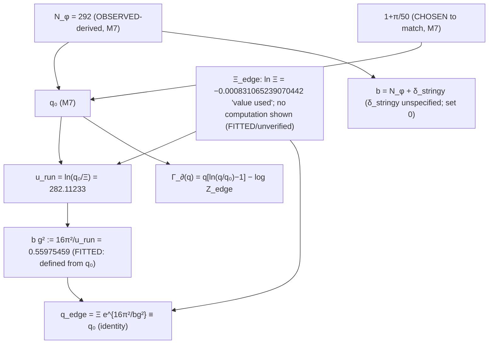
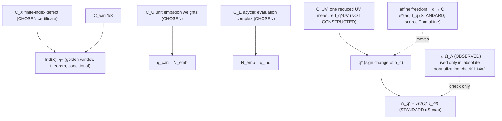

# Parameter provenance of the Λ-selection mechanisms in the FBS3R archive

Scope: all proposed mechanisms for fixing Λ (equivalently the horizon-capacity label
`q = 3π/(ℓ_P² Λ)`) found in `/home/claude/repo/All Preprints` by searching for CIVP, index
lock/locking, boundary Hamiltonian, CP^1, de Sitter horizon, 292, 584, π/50, Lambda and
cosmological constant. The repository was only read; nothing in it was edited.
Line numbers refer to the `.tex` sources.

Formal backbone (Lean 4, Mathlib, axioms only `propext, Classical.choice, Quot.sound`):
* `/home/claude/work/APEX-Lean/APEX/Cosmology/LambdaUnderdetermination.lean` (namespace
  `APEX.Cosmology.Lambda`): `traceFree_dS_family`, `integration_constant`,
  `integration_constant_realised`, `TFEq_vacuum_shift`, `LambdaCap_injective`,
  `selector_nogo`, `affine_reweighting_moves_minimiser`, `poisson_selector_any_target`,
  `gammaEdge_unique_min`, `qEdge_any_target`, `shell_any_integer`.
* `/home/claude/work/APEX-Lean/APEX/Cosmology/Selector.lean` (namespace
  `APEX.Cosmology.Selector`): `exists_minimizer_of_coercive`, `strict_minimizers_adjacent`,
  `tie_example`, `strict_unique_iff`, `quadratic_unique_iff`, `gap_exists`, `stable_of_gap`,
  `tie_at_half_gap`, `softmin_bounds`, `ground_state_selection`, `nogo_shift`, `nogo_group`,
  `nogo_isospectral`, `breaking_term_selects_anything`.

Numbers were recomputed with `/tmp/claude-0/lambda2/nums.py`, using Python stdlib only.

## Leaf classification legend

| tag | meaning |
|---|---|
| INDEPENDENT_MICRO | fixed by stated microscopic premises, with a derivation that is shown in the source and does not use late-time data |
| CHOSEN | a free modelling choice: a functional form, normalization, registry, or polynomial. It is fixed in the text, but nothing forces it |
| OBSERVED | Λ_obs, H₀, Ω_Λ, q_obs, u_obs, or any quantity computed from them |
| FITTED | a number defined by an identity that reproduces an OBSERVED-derived target, or a value asserted to many digits with no computation shown, where the mechanism is invariant under changing it |
| STANDARD | an established physics or mathematics input (ℓ_P, Gibbons–Hawking entropy, de Sitter kinematics, index theorems). It is not a free parameter, but it does not select anything |

**Decision rule for (c).** This is the logic of `Selector.lean`. A selector predicts `q*` only if
(i) `Γ` is built from INDEPENDENT_MICRO and STANDARD leaves alone,
(ii) `Γ` is coercive (`exists_minimizer_of_coercive`), and
(iii) the minimizer is unique with a strict gap δ (`gap_exists`), so that it is stable
under perturbations of size below δ/2 (`stable_of_gap`). The bound δ/2 is sharp (`tie_at_half_gap`).
In the opposite direction:
* if `Γ` is invariant under a fixed-point-free relabelling, nothing is selected (`nogo_group`, `nogo_shift`);
* if the breaking term is arbitrary, anything is selected (`breaking_term_selects_anything`, `selector_nogo`);
* an affine reweighting `Z_q ↦ C e^{aq} Z_q` moves `q*` anywhere (`affine_reweighting_moves_minimiser`).

---

## M0. Trace-free (unimodular) gravity: Λ as an integration constant

*Source:* 2026_08_10 §"Trace-free local dynamics" (l.285–386); repeated in 08_11, 08_12 and 08_17 §2.

(a) The local equations are `R_μν − ¼R g_μν = 8πG (T_μν − ¼T g_μν)`. The Bianchi identity plus
`∇T = 0` give `R + 8πG T = 4Λ` with Λ constant.

(b)

(c) No `q*` is selected. Every Λ ≥ 0 solves the same local equations: Lean `traceFree_dS_family`,
`integration_constant`, `integration_constant_realised`. This is a **standard result**
(Anderson–Finkelstein 1971; Buchmüller–Dragon 1988; Henneaux–Teitelboim 1989; Unruh 1989; Ellis et al. 2011).

(d) Radiative stability:
* **Standard:** a constant vacuum-energy shift `T → T − ρ g` drops out of the
  trace-free equations. Lean `TFEq_vacuum_shift`.
* So matter loops do not renormalize Λ_int through the local equations.
* **Standard:** what remains is a free constant. Its value is a boundary or initial condition, not
  a prediction (Weinberg 1989 RMP 61:1 §VI; Padilla–Saltas 2015 EPJC 75:561). The
  fine-tuning moves into the choice of that condition.
* In the Henneaux–Teitelboim formulation, Λ is conjugate to a 4-volume time and is fixed by the state.

(e) **Missing principle:** a global law that fixes the integration constant.

---

## M1. Horizon-capacity fixation `Λ = 3π/(ℓ_P² N_cap)` with `N_cap = S_dS`

*Source:* 2026_08_10 §"Horizon-capacity fixation" (l.387–497): Hypothesis `hyp:capacity`,
Theorem `thm:capacity-mode`, Criterion `crit:lambda-null`.

(a) `Λ_int = Λ_cap = 3π/(ℓ_P² · Capacity(H_∂; A_grav, Q_DM, P_val))`. The capacity is postulated
to equal `S_dS = 3π/(Λ ℓ_P²)`.

(b)

(c) **No.** The postulate `N_cap = S_dS(Λ)` is solved by every Λ. It is a bijective relabelling
`Λ ↔ q`: Lean `LambdaCap_injective`, `lambda_not_determined_by_structure`. The source says so itself:
"once the entropy-capacity eigenvalue is supplied or computed". With the OBSERVED leaf removed, `q` is free.

(d) The vacuum-shift immunity in Thm `vacuum-shift-immunity` is inherited from M0 and is
**standard**. The N-bound / holographic reading Λ ~ 1/N is Banks 2000 / Fischler and Bousso 2000
(hep-th/0010252). It is a **conjecture**: it bounds the number of states, but it does not select N.

(e) **Missing principle:** an independent computation of `dim H_∂` (or of its log-capacity) from
a boundary theory that has no Λ in its definition.

---

## M2. CP¹ index quantization `q = ind ∂̄_{O(q−1)} = dim H⁰(CP¹, O(q−1))`

*Source:* 08_11 §"Microscopic capacity selection: no-go theorem" (l.2484–2597), nogo `q-selection`;
08_17 §"CP¹ index space and acyclic molecular locking" (l.468–740).

(a) Capacity sectors are labelled by line bundles on S² ≅ CP¹, with `q ∈ ℤ_{>0}`.

(b)

(c) **No.** The authors state this themselves (nogo `q-selection`): topology plus index
*quantize* q but do not select it. In `Selector.lean` terms, without any `Γ` the relabelling
`q ↦ q+1` acts on admissible sectors without a fixed point (`nogo_group`).

(d) Index integers are topological, so they are radiatively exact. This is **standard**.

(e) **Missing principle:** a dynamical weight `Γ(q)` that breaks the label symmetry.

---

## M3. Chern–Simons level lock `k_CS = 6π/(ℓ_P² Λ) = 2q`

*Source:* 08_11 §"Boundary Chern–Simons level lock and the N-bound" (l.3087–3232), citing Smolin
2002 (hep-th/0209079); also 08_12 l.3364.

(a) `N_∂ = k_CS/2`. Selecting Λ is said to be equivalent to selecting the level.

(b)

(c) **No.** Both sides are functions of the same Λ, so the lock is a definitional identity. Every
integer level is an admissible CS theory, and the selection problem is the same problem as before.

(d) An integer level is radiatively stable up to the standard one-loop shift `k → k + h^∨`; this
is **standard** CS lore (Witten 1989). The identification of Λ with the level is a **conjecture**
that holds only inside the LQG boundary picture.

(e) **Missing principle:** a reason, independent of Λ, why a particular level occurs.

---

## M4. Bogomolny–Bradlow saturation and the Planck-cell edge functional

*Source:* 08_11 §"Bradlow horizon packing" (l.3578), §"Bogomolny–Bradlow saturation as a boundary
selector" (l.3687), §"Boundary edge-mode Hamiltonian and entropy-cell locking" (l.3829–3934); repeated in 08_12.

(a) The edge functional is
`Γ^edge = ∫(|D_z̄ψ|² + ½B_A²) + λ_P(τℓ_P² − π)² + λ₀(∫|ψ|²)²`.
Minimizing it in the sharp limit gives `τ = π/ℓ_P²` and `N_v = τ·Area/4π = q`.

(b)

(c) **No.** Saturation ties the vortex number to the area, but the area (that is, Λ) stays free:
any radius gives a saturated vortex sector. The penalty terms impose the Planck cell by hand.
This is a CHOSEN breaking term of exactly the type in `breaking_term_selects_anything`.

(d) The BPS bound is topological (**standard**). Away from critical coupling, the stability of the
penalty terms `λ_P, λ₀ → ∞` under radiative corrections is not addressed in the source.

(e) **Missing principle:** a dynamical reason for both critical coupling and the Planck-cell
normalization, and then still a selector for the area.

---

## M5. APS-η / determinant-line selector `Γ^{ζη}`

*Source:* 08_11 §"APS eta and determinant-line selector" (l.4442–4562) and §"Concrete edge Dirac
operator…" (l.4563); 08_12 l.4721–5018.

(a) The functional is
`Γ^{ζη}(q) = Γ^HS(q) + λ_ζ[−½ζ'_q(0) − Θ_φ(q)]² + λ_η sin²[π η_q(0)/2 − θ_CS(q)]`,
with `Θ_φ(q) = ln[πφ^{2N(q)}/q]`.

(b)

(c) **No.** The source's own spectrum `λ = ±R⁻¹√(ℓ(ℓ+q))` (08_12 l.8155, 9393) is symmetric, so `η_q(0) = 0`
for every q and the η term does not depend on q. The ζ term compares the determinant with a
*target* `Θ_φ` that is defined through the φ-shell of M7, so it inherits M7's OBSERVED leaf.

(d) ζ-determinants depend on the scheme through a local counterterm. That counterterm is exactly
an affine term `a q + b` for an extensive quantity (**standard**: heat-kernel / Seeley–DeWitt
ambiguity), and an affine term moves the minimizer (`affine_reweighting_moves_minimiser`).

(e) **Missing principle:** a scheme-independent spectral quantity that has a q-dependent sign
change at a q set by the operator alone.

---

## M6. Bradlow sigma-model (GLSM on CP^{k−1}) candidate

*Source:* 08_11 §"A first explicit candidate, and its refutation" (l.7252–7333).

(a) This is a transmutation selector with `B ∝ k = q`.

(c) **Refuted by the authors themselves.** Matching `u* = ln q_obs` requires
`λ(0) = 2π/(B u*) ≈ 6.7·10⁻¹²⁵`, which is a restated hierarchy. That target is OBSERVED.

(e) **Missing principle:** the same as M8.

---

## M7. Fibonacci shell + valuation phase defect `q₀ = π φ^584 / (1 + π/50)`

*Source:* 08_12 §"Reader-facing status" (l.163–323), §"Fibonacci–valuation phase compression"
(l.6158–6379), Prop. on π/50 (l.2930–2958, 3140–3205); also 08_11 l.5768. The registry clock is
in §"Fibonacci renormalization clock" (l.5965).

(a) The ingredients are:
* the shell coordinate `n(q) = log_φ √(q/π)`;
* `N_φ = round n(q_ledg) = 292`;
* `d_val = dim R[z]/(P_val) = 5`, with `P_val = (z−1)z(z+1)(z+2)(z+3)`;
* `Θ_FV(d) = ln(1 + π/(2d²))`;
* the product `q_FV(N,d) = πφ^{2N}/(1+π/(2d²))`;
* the selector `Γ^FV = A[ln q − ln q_FV(N,d)]² + Γ_adm`.

(b)

Classification: N_φ = 292 is **OBSERVED-derived**. 08_12 l.6162–6217 computes it from H₀ = 67.4,
Ω_Λ = 0.685 and calls it the "recovered origin of 292". The edge recursion `Fix_ℤ R = 292` is
explicitly "an edge-selector target, not an additional theorem" (l.8570–8573). The factor
1 + π/50 is **CHOSEN to match** the observed residual:
* the source itself calls it "a registry coincidence unless it follows from a boundary action" (l.2944–2950);
* it is "a phase-defect clue, not a theorem" (l.3153);
* recomputed: ε_φ = πφ^584/q_obs − 1 = 0.0628440, and ε_φ − π/50 = 1.22·10⁻⁵;
* the formula `π/(2d²)` has no derivation in the text. Nearby d give 1.098 (d=4) and 1.044 (d=6).

(c) **No.** Remove the OBSERVED leaf and N is free. `q_FV(N,5)` is then a one-parameter family
(Lean `shell_any_integer`: every integer N is the shell of `q = πφ^{2N}`), and `Γ^FV` has the unique
minimizer `q_FV(N,d)` for whatever N is put in (`selector_nogo`, `breaking_term_selects_anything`).
The shell symmetry `N ↦ N+1` (Λ ↦ Λ/φ²) is unbroken by any INDEPENDENT_MICRO leaf (`nogo_shift`).

Robustness note: N = 292 is obtained for every H₀ in [51.4, 83.1] km/s/Mpc at Ω_Λ = 0.685. This
coarse robustness is a property of any logarithmic shell coordinate, because adjacent shells differ
in Λ by φ² ≈ 2.618. It is not evidence of a derivation.

(d) Integers and the number π/50 are not renormalized. The question is provenance, not radiative
stability. The quadratic selector `A(ln q − ln q₀)²` is exactly the type in `quadratic_unique_iff`:
it has a unique integer minimizer whenever `q₀` is not a half-integer.

(e) **Missing principle:** a boundary Hamiltonian whose spectrum computes N = 292 *and*
Θ = ln(1+π/50) without q_obs. The source states exactly this as the open target (l.6372–6377).

---

## M8. Edge transmutation `q_edge = Ξ_edge exp(16π²/(b g_∂²))` and `Γ_∂(q) = q[ln(q/q₀) − 1] − log Z_edge(q)`

*Source:* 08_12 Criterion `crit:autonomous-edge-selector` (l.250–312); Thm
`thm:autonomous-terminal-edge-gates` (l.9293–9480); §"Boundary-running transmutation"
(l.8796–8860); §"Selector free energy" (l.8862–8900). Trichotomy: 08_11 Thm
`thm:selector-trichotomy` (l.7182).

(a) The claimed gates are G1 `Spec(R) ⇒ 292`, G2 `det'D ⇒ Ξ_edge = 0.99916928` and
G3 `A_edge ⇒ b g² = 0.5597545859987624455`. Together they give `q_edge = q₀ = 3.307251460713979·10¹²²`.

(b)

Classification:
* **b g² is FITTED.** It is *defined* by `b g² = 16π²/ln(q₀/Ξ)`. The source says "may be read in
  either direction" (l.8850–8857) and G3's proof computes it from q₀ (l.9444–9468).
* So `q_edge = q₀` is an algebraic identity for **every** Ξ > 0. Recomputed: Ξ = 0.5, 1, 2
  give b g² = 0.558384, 0.559756, 0.561135, and each reproduces q₀ exactly.
* **Ξ_edge.** The ζ-function data of the monopole Dirac operator are STANDARD. The finite part
  "after zero-mode subtraction, heat-kernel subtraction, APS framing, the Harish-Chandra edge-character
  term, and the Kronecker-limit finite normalization" is asserted as a number to 15 digits, with no
  evaluation shown. Its value has no effect on q_edge. I classify it as FITTED/unverified (at best
  CHOSEN scheme): the source shows no evaluation, so it cannot be INDEPENDENT_MICRO.

(c) **No.**
* Remove the OBSERVED leaf (via q₀) and the FITTED leaf (b g²), and q_edge = Ξ exp(16π²/B) takes
  every value > Ξ as B ranges over (0, ∞) (Lean `qEdge_any_target`).
* `Γ_∂ = q[ln(q/q₀) − 1]` has the unique minimizer q₀ for every input q₀ (`gammaEdge_unique_min`).
  Its location is the input.
* The source's own criterion (l.307–310) says: "If q₀, N_φ, or the observational capacity is used to
  set Ξ_edge or b g², the statement is a matching identity, not an autonomous selector." By the
  source's own text, b g² is set from q₀ (l.9444–9468). So by the authors' criterion, M8 is a
  matching identity.

(d) Radiative and scheme stability:
* **Standard:** dimensional transmutation is technically natural (as for Λ_QCD).
* It is exponentially sensitive: `δ ln q = −(u²/16π²) δ(bg²) ≈ −504 δ(bg²)`. A 1% accuracy in Λ
  needs b g² to about 2·10⁻⁵ absolute.
* **Standard:** two-loop terms `(b₁/b₀²) ln u` and scheme changes shift u by O(1), that is, they
  change Λ by O(1) factors unless the scheme is fixed by physics.
* **Discrete stability (Selector.lean):** for `Γ_∂ = q[ln(q/q₀) − 1]` the gap is
  `δ ≈ Γ''/2 = 1/(2q₀) ≈ 1.5·10⁻¹²³`. A perturbation of Γ larger than δ/2 can move q* by ±1
  (`stable_of_gap`, `tie_at_half_gap`). This is harmless observationally, since ΔΛ/Λ ~ 10⁻¹²², but
  it means a claim of uniqueness *of the integer* is not robust.
* More importantly, an affine term `a q` (a boundary tension, which 08_17 calls scheme freedom) shifts
  `ln q*` by exactly `−a`, that is, ΔΛ/Λ ≈ a. Λ is predicted only to the accuracy to which the
  linear coefficient is controlled (`affine_reweighting_moves_minimiser`).

(e) **Missing principle:** an edge theory with fixed field content in which the one-loop coefficient
b, the scheme-fixed coupling at ℓ_P⁻¹, and the finite part Ξ are *computed*, with no reference to
q₀. Equivalently, a UV boundary condition `g_∂(ℓ_P⁻¹)` fixed by a symmetry or fixed point.

---

## M9. CIVP index locking + invariant UV selector (2026_08_17)

*Source:* 08_17 §"Invariant UV selector calculus" (l.1525–1652), §"Conditional closure and
irreducible physical certificates" (l.2012–2116).

(a) The partition function is `Z_q^UV = I_q^UV / Γ(q+1)` and the free energy is `Γ_q = −log Z_q^UV`.
`Δ²Γ_q = log((q+2)/(q+1)) − κ_q` with `κ_q = Δ² log I_q`. The unique-selector theorem asks for strict
convexity plus one sign change of `ρ_q`. The closure needs five certificates
`C_X, C_win, C_U, C_E, C_UV`. If they hold, `Ind(X) = φ²` and `q_can = N_emb = q_ind`, and
"the reduced UV measure selects one integer q*".

(b)

(c) **Conditional, and not yet a selector.** No OBSERVED leaf enters the defining data, so this is
the only mechanism with clean provenance. But `I_q^UV` is not constructed. The source proves itself
(Prop. `irreducible`) that without `C_UV` the affine reweighting leaves κ unchanged and moves q*.
This matches Lean `affine_reweighting_moves_minimiser` and `poisson_selector_any_target`.
Strict convexity alone allows a tie (`tie_example`). Uniqueness holds exactly when the adjacent
values differ (`strict_unique_iff`). This refines the source's sign-change condition, which assumes
`ρ_{q*} < 0` strictly. The bounded-growth no-go (08_17 Thm `boundedgrowth`) is correct. Selector.lean's
`ground_state_selection` adds that at large β only ground-state energies matter, so `I_q^UV` must
carry growth ~ q! from its ground-state structure.

(d) The source cites Khoury–Muntz–Padilla 2026 for "constant shifts cancelled, Casimir/winding terms
survive". I have **not verified** that citation; it comes from the source. The logic it imports is
standard for sequestering-type constraints.

(e) **Missing principle:** the certificate `C_UV`, a single microscopic measure whose
*unreduced linear datum* (the coefficient `a` in `e^{aq}`) is fixed. The source states this itself.

---

## M10. Phase-wavefunctional acceleration (2025_10_12, two papers)

*Source:* "Geometric Acceleration on Compact S³ Without a Fundamental Λ" (l.84–91, 277) and the
companion CMC-gauge paper.

(a) `H = ⅓ d(Δθ)/dt` and `Λ_eff = 3H_∞²/c²`.

(b) `H_∞ (FITTED: "does not … derive the saturation scale H_∞ from UV microphysics", l.277) → Λ_eff`.

(c) **No.** H_∞ is a free late-time constant, which is equivalent to Λ.

(d) This is not addressed. Any constant effective vacuum term has the standard radiative-instability
problem unless it is protected (e.g. by a shift symmetry of Δθ).

(e) **Missing principle:** a derivation of H_∞.

---

## M11. Non-mechanisms that are explicitly disclaimed

* 2026_05_15 (amplitude-selection boundary): proves that the homogeneous residual is locally ΛCDM,
  and that "compact topology … does not by itself determine Ω_Λ or Λ_eff". This is a no-go and is
  consistent with M0.
* 2026_05_05: compact-S³ Casimir energy `ρ = 1/(480π² a⁴)`. It scales as a⁻⁴ (radiation-like), so it
  cannot be Λ. The source disclaims it as a prediction of dark energy.

---

## (d) Comparison table: radiative stability and alternatives

| statement | status |
|---|---|
| Weinberg no-go (1989, RMP 61:1): no adjustment mechanism with a finite number of fields and translation-invariant, constant-field vacua sets Λ_eff = 0 without fine-tuning | **standard theorem** (under its assumptions) |
| Unimodular / trace-free gravity removes constant vacuum energy from the field equations; Λ becomes an integration constant | **standard** (Lean `TFEq_vacuum_shift`, `integration_constant`) |
| …but it does not fix the integration constant; tuning moves to boundary data | **standard** (Weinberg 1989; Padilla–Saltas 2015) |
| Kaloper–Padilla vacuum-energy sequestering (PRL 112, 091304 (2014); PRD 90, 084023 (2014); local version Kaloper–Padilla–Stefanyszyn–Zahariade PRL 116, 051302 (2016)): global constraints cancel all loop vacuum energy; residual Λ_eff = ¼⟨T⟩ spacetime average, radiatively stable, requires finite spacetime volume | **standard as a published proposal**; its phenomenology (finite 4-volume, future crunch) is model-dependent |
| Henneaux–Teitelboim: Λ is canonically conjugate to a 4-volume time | **standard** |
| Bousso–Polchinski discretuum + anthropic selection (Weinberg 1987) | **standard proposal**, not a dynamical selector |
| Banks/Fischler–Bousso N-bound Λ ~ 1/N | **conjecture** |
| Smolin 2002: k_CS = 6π/(GΛ) in positive-Λ LQG | **conjecture** within LQG |
| Dimensional transmutation is technically natural, but exponentially sensitive to the UV coupling | **standard** |
| Khoury–Muntz–Padilla 2026 (as cited in 08_17) | **cited by the source, not verified here** |
| Any "Γ(q) = argmin" selector at q ~ 10¹²² with Γ'' ~ 1/q has an integer gap ~10⁻¹²³; an affine term moves ln q* one-to-one | **proved** (Selector.lean, LambdaUnderdetermination.lean) |

Relation to sequestering:
* M0/M1 already obtain the local vacuum-shift immunity that sequestering is designed to provide.
* Sequestering *does* fix the residual, as a historic average of T. So it gives a definite (though
  generally non-predictive) value with no observed input.
* The FBS3R mechanisms add a capacity label instead, and that label is not fixed.
* A FBS3R-compatible minimal completion therefore needs either a sequestering-type global constraint
  that relates `q` to a computable spacetime average, or a boundary Hamiltonian as in M8/M9.

---

## Overall verdict

| id | mechanism | unique q* without OBSERVED/FITTED leaves? | verdict |
|---|---|---|---|
| M0 | trace-free integration constant | no (continuum) | standard; selects nothing |
| M1 | horizon-capacity fixation | no (tautological relabelling) | relabelling Λ ↔ q |
| M2 | CP¹ index quantization | no (all q ∈ ℤ>0) | quantizes, does not select (authors agree) |
| M3 | CS level lock k = 2q | no (identity) | relabelling |
| M4 | Bogomolny–Bradlow / Planck-cell edge functional | no (area free) | normalization by penalty terms |
| M5 | APS-η / determinant selector | no (η ≡ 0; ζ target from M7) | inherits M7 |
| M6 | Bradlow sigma-model | no (needs λ ~ 10⁻¹²⁵) | refuted by authors |
| M7 | Fibonacci shell + 1+π/50 | no (N = 292 is OBSERVED-derived; π/50 is a matched form) | numerology plus a conditional target |
| M8 | edge transmutation gates | no (b g² defined from q₀; any Ξ works) | matching identity by the authors' own criterion |
| M9 | CIVP index locking + UV selector | not determined (C_UV missing) | clean provenance, incomplete; the only viable programme |
| M10 | phase wavefunctional | no (H_∞ fitted) | phenomenological |

**Common minimal missing principle.** Every mechanism needs one independently justified
symmetry-breaking term in `Γ(q)` that is coercive and has a strict gap at a unique `q*`, and is
built only from INDEPENDENT_MICRO leaves. In particular it must fix the linear (boundary-tension)
coefficient `a` that the affine scheme freedom leaves open. `Selector.lean` shows why:
* with the shift symmetry unbroken, nothing is selected (`nogo_shift`, `nogo_isospectral`);
* with an arbitrary breaking term, anything is selected (`breaking_term_selects_anything`);
* the observed value cannot be an input of the breaking term without making the result circular.
